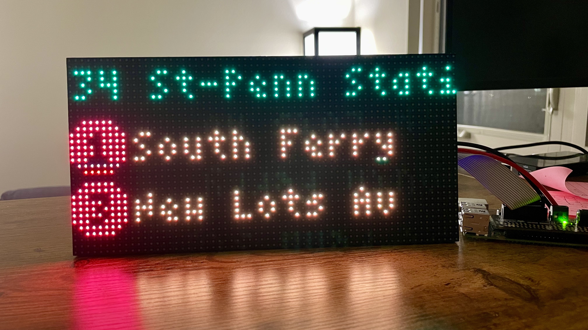
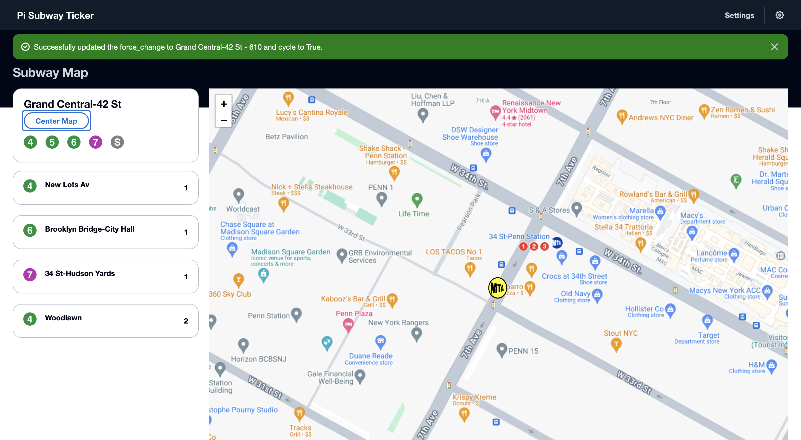
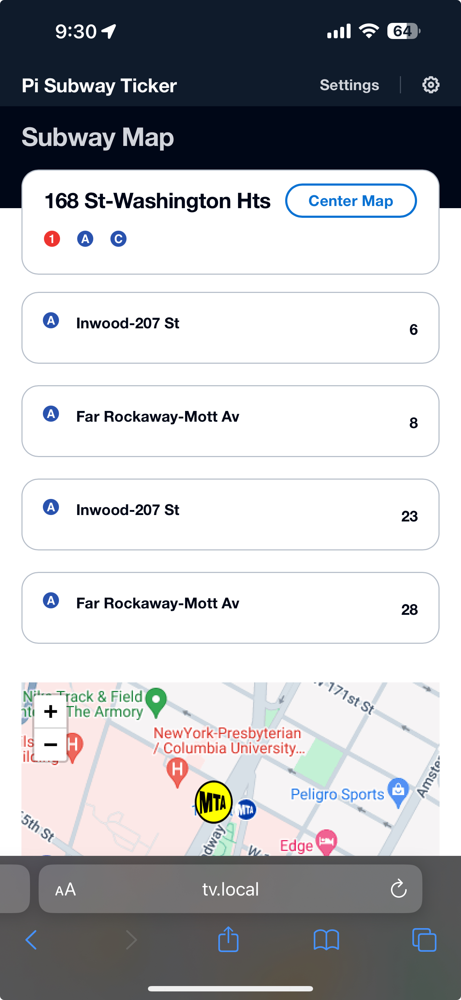

# Nuggies Pi Displays

A unified Raspberry Pi RGB LED matrix display system. Switch between an MTA subway departure board and a live stock ticker — all controlled from a responsive web app on your phone or desktop.

---

## Displays

### MTA Subway
Real-time departure times for your chosen NYC subway station, with station cycling and an interactive map to switch stations from the web UI.

| Penn Station | Yankee Stadium |
|:---:|:---:|
|  |  |

### Stocks
*(photos coming soon)*

---

## Web UI

| Desktop | Mobile |
|:---:|:---:|
|  |  |

### System page

The **System** page manages the device itself:

- **Update & Reboot** — pulls the latest code, re-runs `setup.sh --update`, and
  reboots. When an update is available, expand **"What's included"** to see the
  commit messages that will be applied before you install. During the update a
  modal streams live progress from the Pi (and detects the mid-update reboot,
  showing a "reconnecting" state until the device returns).
- **Restart Services** — restart the API, display, or website service
  individually without rebooting the whole Pi.
- **Restart Pi** — full reboot.
- **Danger Zone** — reset settings, or a full factory reset + WiFi wipe.

---

## Hardware

- Adafruit 64×32 RGB LED matrix (single panel)
- Adafruit RGB Matrix HAT/Bonnet
- Raspberry Pi (tested on Pi 4)
- 2× Adafruit STEMMA tactile buttons (3-wire: signal/3.3V/GND)

### Button Wiring

| | Button 1 (cycle left) | Button 2 (cycle right) |
|---|---|---|
| **White** (signal) | Pin 22 / GPIO 25 | Pin 35 / GPIO 19 |
| **Red** (3.3V) | Pin 17 | Pin 1 |
| **Black** (GND) | Pin 20 | Pin 34 |

See [display/BUTTON_WIRING.md](display/BUTTON_WIRING.md) for the full header map.

### Physical Controls

**Single button (tap):**
- **Button 1** — cycle to the previous display mode.
- **Button 2** — cycle to the next display mode.

**Button 1 held ~10s** — reboot the Pi.

**Both buttons held together** — a timed action with on-screen feedback:

| Hold duration | Action |
|---|---|
| Released < 3s | Nothing (treated as an accidental tap) |
| Released 3–10s | **Sports mode only:** cycle to the next sport (MLB → NBA → WNBA → NFL → NCAAF → NHL → NWSL) |
| Held ≥ 5s | Display shows a **"FACTORY RESET — Hold Ns"** countdown |
| Held ≥ 10s | Display shows **"FACTORY RESET"** and performs a full factory reset (settings wiped, WiFi forgotten, reboot into setup) |

While both buttons are held, single-button cycling is suppressed so the display
doesn't change underneath you mid-hold.

---

## Setup

```bash
git clone <repo-url> nuggies_pi_displays
cd nuggies_pi_displays
chmod +x setup.sh
./setup.sh
```

`setup.sh` installs system packages, Node.js 22, Python dependencies, builds the RGB matrix library, and configures sudoers for the display processes.

---

## Running

### Option 1 — Development (screen sessions)

Runs the API with hot-reload and the website dev server in named `screen` windows. Good for active development.

```bash
# Start API in a screen session
screen -S nuggies-api -dm bash -c 'cd /home/pi/nuggies_pi_displays/api && python3 -m uvicorn main:app --host 0.0.0.0 --port 8000 --reload'

# Start website dev server in a screen session
screen -S nuggies-web -dm bash -c 'cd /home/pi/nuggies_pi_displays/website && npm start'
```

Attach to a session to see logs:
```bash
screen -r nuggies-api   # Ctrl+A then D to detach
screen -r nuggies-web
```

List all sessions:
```bash
screen -ls
```

Kill a session:
```bash
screen -S nuggies-api -X quit
screen -S nuggies-web -X quit
```

---

### Option 2 — Production (systemd services)

Registers the API and website as systemd services that start on boot and automatically restart on failure.

**1. Create the API service:**

```bash
sudo tee /etc/systemd/system/nuggies-api.service > /dev/null <<EOF
[Unit]
Description=Nuggies Display API
After=network.target

[Service]
User=pi
WorkingDirectory=/home/pi/nuggies_pi_displays/api
ExecStart=python3 -m uvicorn main:app --host 0.0.0.0 --port 8000
Restart=always
RestartSec=5

[Install]
WantedBy=multi-user.target
EOF
```

**2. Create the website service:**

```bash
sudo tee /etc/systemd/system/nuggies-web.service > /dev/null <<EOF
[Unit]
Description=Nuggies Display Website
After=network.target nuggies-api.service

[Service]
User=pi
WorkingDirectory=/home/pi/nuggies_pi_displays/website
ExecStart=npm run build && npx serve -s dist -l 8080
Restart=always
RestartSec=5

[Install]
WantedBy=multi-user.target
EOF
```

**3. Enable and start:**

```bash
sudo systemctl daemon-reload
sudo systemctl enable nuggies-api nuggies-web
sudo systemctl start nuggies-api nuggies-web
```

**Check status / logs:**

```bash
sudo systemctl status nuggies-api
sudo systemctl status nuggies-web

sudo journalctl -u nuggies-api -f
sudo journalctl -u nuggies-web -f
```

**Stop / disable:**

```bash
sudo systemctl stop nuggies-api nuggies-web
sudo systemctl disable nuggies-api nuggies-web
```

---

## Project Structure

```
nuggies_pi_displays/
├── setup.sh                  # Full install script
├── requirements-api.txt
├── requirements-display.txt
├── api/                      # FastAPI backend (port 8000)
│   ├── main.py
│   ├── run_api.sh
│   ├── helpers/              # Settings, logging, process management
│   └── endpoints/            # system/, mta/, stocks/
├── display/                  # LED matrix display processes
│   ├── mta/                  # MTA subway display
│   └── stocks/               # Stock ticker display
└── website/                  # React + Cloudscape web UI (port 8080)
    └── src/
        ├── hooks/            # useQuery data hooks
        ├── pages/            # home, mta, stocks, system
        ├── components/       # Map, train cards, etc.
        └── services/         # Axios API client
```

---

## API

See [api/README.md](api/README.md) for the full endpoint reference.

Interactive docs available at `http://<hostname>.local:8000/docs` (replace `<hostname>` with the
device's hostname — whatever the image was flashed with; use the device's IP address if your client
can't resolve `.local`).
